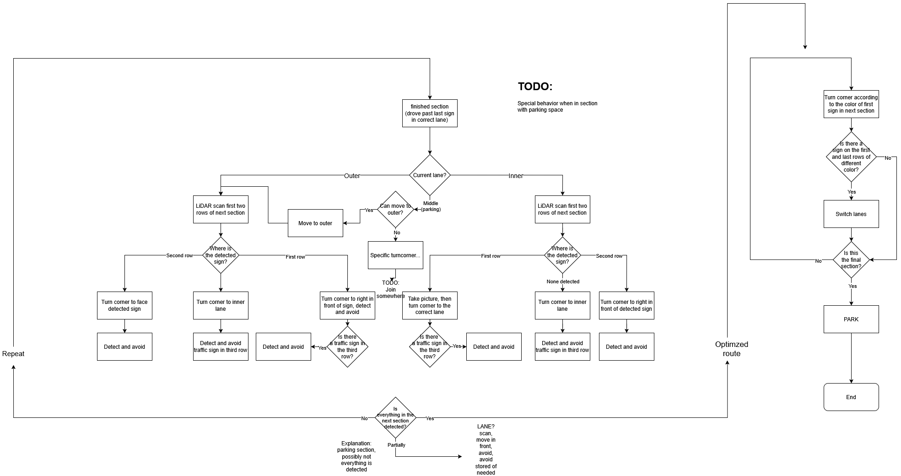

# Engineering Journal
This document shows our progress in a monthly basis. It is updated live during our preparation, beginning from the start of the 2026 season of Future Engineers, 2026. january.

## January
We begun by reading and interpreting the rules. Since the main challenge didn't change it was clear most of our time would be spent improving the documentation, and preparing for possible surprise rules. To start we looked at the top teams' documentation, looking for things to learn/improve, especially in scoring areas they achieved exceptional results in. 

A list of the different teams' documentation we reviewed with a short note of our takeaway:
- Team Double-X: Their solution is vastly different from ours, but their use of flowcharts and GitHub issues seem like a good idea
- Team KMIDS GFM: Their solution is more similar to ours, though they do rely more heavily on the camera. Initially we avoided this, but it might be something we have to attempt this year
- Team FireOnAllCylinders: Their Learning Journey is in part the inpsiration for this document
- Team ANTİ: Their robot is vastly different from ours. It's speed and form factor is outsanding, but it's not something we would attempt

## February
This month was uneventful, mainly because the first few weeks of university took up most of our time.

## March
`03.13.:` We finally dusted off the robot for some  tests. It performed remarkably well out of the box, but of course we had to fine-tune some calibrations. During this fine-tuning however we  managed to short-circuit our ESP, completely frying it in the process. This was a valuable lesson as this isn't the first time we managed to kill an ESP, so we will make sure to bring backup ones to the competition. Luckily we managed to get it replaced pretty quickly.

`03.25.:` RoboTech Challenge Day 
We were invited to the National/Central European demo competition RoboTech, where among other categories they had a WRO Future Engineers competition. It was a great opportunity for us to practice on a foreign track in different conditions, and the robot did not dissappoint, managing to score full points after some calibrations.

## April
`04.17.:` We discussed possible improvements of the robot, such as the creation of a new PCB and it's new features. We also decided to implement a new obstacle challenge strategy to reduce our time by a significant amount.

`04.28.:` We started work on creating the improved strategy. It will make the run much more complicated than before, and since simplicity and straight-forwardness is very important to us we had to make sure it remained clear and understandable. We made a work-in-progress flowchart, and started implementing parts of it. Whether we finish it for the nationals or not is not certain.  

## May
We started implementing the new strategy in parts, and quickly realized this is not the way forward to the nationals. The number of cases grew exponentially and we didn't have enough time before the nationals to finish properly implementing it. We instead made a compromise between the new strategy and the old one that enables us to keep the simplicity of the old strategy with significant timesaves. After deciding on this strategy we quickly started implementing and testing it.

## June
`06.10.:` We finished implementing the strategy and tested it to our best ability. We are really happy with the results. We also had to start planning the documentation and preparing for the surprise rule.

`06.15.:` The surprise rule was announced. We prioritized solving it, pausing documentation work meanwhile. We managed to solve it fairly easily, but we also have to test the full run with the surprise rule thoroughly.

`06.26-27.:` The date of the nationals. We did our best and managed to achieve maximum points for both challenges, securing the qualification to the international finals! We had a great time meeting and interacting with other teams!  
See you in Puerto Rico!

## July
We wrote up everything we will need to improve for the internationals while the experience of the competition was still fresh. We found quite a lot of things, but decided to spend the last month of the summer relaxing, not doing anything notable.

## Augustus
`08.14.:` The national organizers arranged a Future Engineers practice for teams looking to practice, so we took the opportunity to dust off the robot and run a few practice laps. We had to undo the surprise rule changes, but the robot performed well, and we also got to meet other teams!  
`08.25.:` We made the decision to switch to a differential gearbox with a different ratio, giving us less speed but more torque. This would allow us to move much more precisely especially on low speeds, like when parking.  
`08.29.:` We installed the new differential gearbox, including better bearings for a better axle connection. We also improved the ESP speed detection based on the encoders by listening to both the rising and falling of the pins, doubling out resolution. After two big hardware changes like these we had to recalibrate the movement of the robot heavily.  
## September
We suspect that the international final may come down to the time of the obstacle challenge. Due to this we had to improve it. one of the first things we tried was the installation of a new laser-distance sensor, TFLuna, which enabled us to receive measurements 100 times a second looking forward, a huge improvement from the previous 15 Hz of the LiDAR.  
`09.16.:` We workshopped ideas on how to get faster, and decided the first challenge is to improve the overall movement of the robot. We eliminated deadzones from the PWM control algorithm giving us much better speed control. After that we calibrated the basic movements of the robot as close to perfection as we could, so we could measure how fast realistically the robot can complete the map.  
`09.23.:` We measured the different characteristics of the robot on different speeds, such as turning radius, maximum acceleration/deceleration without slipping etc. We also had to calibrate the PID control of the speed and straightkeeping, optimizing for faster speeds. After we had the data we could start optimizing the obstacle challenge run.  
`09.28.:` We installed the new ESP board which helps us make the robot's wiring cleaner and more reliable.
## October
`10.11-12.:` We spent the weekend implementing the optimized obstacle challenge strategy. This proved to be more challenging than we initially thought, as the forces of physics were actively working against us :( . Moving at such high speeds presented so many new challenges we haven't yet faced before which made us respect the slow and steady strategy we initially had. But, since time is might be the deciding factor we had to try out best, plus experiencing these struggles was definitely a learning moment for us. For example we had to account for the robot's centre of gravity, which made accelerating backwards and forwards behave completely differently. We also had to avoid the robot slipping ever, which lead to heavy regulation of deceleration, making us realize stopping is harder than we thought without actual brakes.